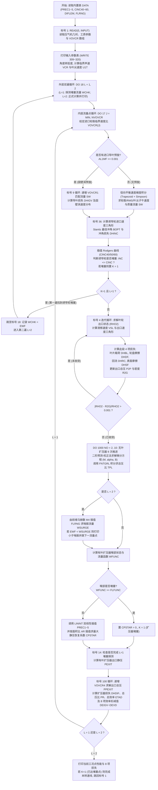
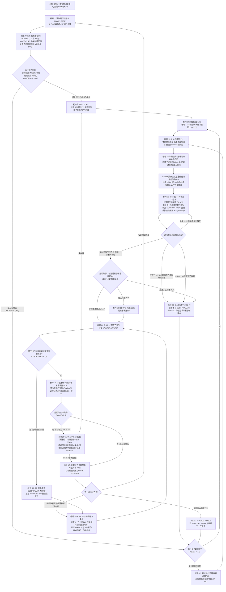

# NASA 离心压气机与向心透平：源码阅读与运行指南

本指南对工作区中的两套经典 NASA 叶轮机械一维气动性能预测程序进行**主要计算段拆解、物理公式映射与运行练习**：
1. **离心压气机变工况程序（NASA TN D-7487, 1973）**：[compressor_tn_d7487.f](../../originals/compressor_tn_d7487.f)（原报告：[压气机程序 (Compressor Program).pdf](../../reports/%E5%8E%8B%E6%B0%94%E6%9C%BA%E7%A8%8B%E5%BA%8F%20%28Compressor%20Program%29.pdf)）
2. **向心透平设计/变工况程序（NASA TN D-8063, 1975）**：[turbine_tn_d8063.f](../../originals/turbine_tn_d8063.f)（原报告：[透平程序 (Turbine Program).pdf](../../reports/%E9%80%8F%E5%B9%B3%E7%A8%8B%E5%BA%8F%20%28Turbine%20Program%29.pdf)）

**2026-10-24 修订。** 本指南中的 `L…` 链接定位到 `originals/` 保留的早期转录文件，便于追溯；它们不表示逐字符认证过的 NASA 官方分发源码。实际运行使用 [restored 压气机](../../restored/compressor_tn_d7487.f)和 [restored 透平](../../restored/turbine_tn_d8063.f)，修复位置见[来源映射](../../restored/SOURCE_MAP.md)。流程图展示主要计算路径，现代输入检查与失败退出另见运行章节。

开始前先读[清单差异与单位说明](../CODE_CAVEATS.md)：SI 透平 `N/TOR/NS` 等字段不能直接按旧教程单位套用；压气机扩压器推进次数也与旧教程不同。教程修订不代表这些历史计算语句已经修改。

---

## 一、 宏观全局视角：这两套程序是什么、解决什么问题？

在燃气轮机、涡轴发动机、航空辅助动力装置（APU）、涡轮增压器以及空间布雷顿循环发电系统中，**离心压气机（Centrifugal Compressor）**与**向心透平（Radial-Inflow Turbine）**是最核心的做功与增压部件。

这两套由 NASA Lewis 研究中心（现 Glenn 研究中心）开发的程序，是叶轮机械气动热力学领域的一维平均流线分析程序。它们解决的核心工程问题是：
* 在已知叶轮与扩压器/静叶的**宏观几何尺寸**（进出口直径、叶片角、叶高、喉部面积、叶片数等）和**进口工质状态**（总温、总压、比热比、气体常数、粘度）的前提下；
* 不建立三维 CFD 网格，求解沿子午流道各关键截面的**速度三角形（Velocity Diagrams）**、**热力学状态参数（静温、静压、总温、总压、密度、马赫数）**以及**各项流动损失（冲角、摩擦、叶片载荷、回流、扩压等）**；
* 在几何、物性及经验关联式适用范围内估计特性图和边界。压气机喘振边界是经验估计；它不是系统动态失稳仿真，也不能保证任意新数据均得到有效解。

### 两套程序的核心设计思想对比

| 维度 | 离心压气机程序 ([compressor_tn_d7487.f](../../originals/compressor_tn_d7487.f)) | 向心透平程序 ([turbine_tn_d8063.f](../../originals/turbine_tn_d8063.f)) |
| :--- | :--- | :--- |
| **物理过程** | 叶轮对气体做功增压（逆压梯度流动，极易分离、失速与喘振） | 高温高压气体膨胀对转子做功（顺压梯度流动，易出现跨声速/超声速堵塞与后膨胀） |
| **计算模式** | **纯正算模式**：给定几何 + 转速 + 一组进口速度比 $`(V/V_{\text{cr}})_0`$，直接利用内置的 8 项经验损失关联式算出压比、效率及喘振/堵塞边界 | **双模式（先标定、后变工况）**：<br>1. **设计模式（`MODE=2/5`）**：输入设计点流量、压比、效率，用弦截法自动反算静叶总压比 `PD` 与转子损失系数 `XK`<br>2. **变工况模式（`MODE=0/1/3/4`）**：固定标定好的 `PD` 与 `XK`，扫描转速与静叶出口速度比 $`(V/V_{\text{cr}})_1`$ 算全特性图 |
| **单位制支持** | 仅国际单位制（SI：$`\text{m}, \text{kg}, \text{s}, \text{K}, \text{N/m}^2`$） | 支持国际单位制（SI，`MODE=0,1,2`）与美制工程单位（US Customary，`MODE=3,4,5`） |
| **边界处理亮点** | **双遍扫描法（Two-Pass Iteration）**：第一遍探明堵塞流量 $`w_{\text{choke}}`$，第二遍利用 $`M_4`$ 喘振准则剔除小于 $`w_{\text{surge}}`$ 的不稳定点 | **二分逼近堵塞 + 堵塞后超临界偏转**：用抛物线拟合与步长细分逼近模型的转子通流极限，并在堵塞后固定上游流量、自动偏转出口气流角 $`\beta_4`$ 按轴向相对临界速度比接近/超过 1 的规则逼近近似极限载荷 |

---

## 先学会读 FORTRAN 的基本语法

不用先背完整变量表。先分清“输入量”“由公式计算的量”“迭代猜测”“控制标志”，每次追踪一个量从哪里来、在哪里被覆盖、最后如何输出。

| 代码形式 | 怎样读 |
| --- | --- |
| 第 1～5 列的数字 | 语句标号，如 `100`；不是编辑器的第 100 行 |
| 第 6 列的非空且非 0 字符 | 固定格式续行；下一行继续上一条语句，常见 `1`、`2` 不是乘数 |
| 第 7～72 列 | 固定格式语句主体；行首 `C` 通常是注释。现代 `.f90` 文件另用自由格式 |
| `X=...` | 赋值，先求右边再覆盖左边；不是数学恒等式 |
| `**`、`SQRT`、`EXP` | 乘方、平方根、指数；`.5` 是 0.5，`1.E-5` 是 $`10^{-5}`$ |
| `A(I)`、`DO ... I=2,10` | 数组通常从 1 开始；这里循环含 2 和 10，共 9 次 |
| `.LT.` / `.LE.` / `.GT.` / `.EQ.` | 小于 / 小于等于 / 大于 / 等于；`.AND.` 是逻辑“且” |
| `IF(X) 10,20,30` | 算术 IF：X 为负、零、正时分别跳到标号 10、20、30 |
| `GO TO (10,11),K` | 根据整数状态 K 选择分支；不能把状态编号当作物理量 |
| `CALL GETK(...)` | 调用子程序；传入变量可能被修改，需继续追踪返回后的值 |
| `SUBR(X,G)=...` | 声明区的语句函数，为一段表达式命名，不是一次运行赋值 |
| `WRITE(6,501)` / `FORMAT` | 按格式 501 输出到标准输出；数字会按字段宽度与小数位舍入 |

旧 FORTRAN 默认 I～N 开头的名字为整数，其他名字为实数；显式类型声明优先。例如压气机用 `REAL ... N,INC,LOD ...` 将这些名字指定为实数。变量名不区分大小写。两份程序中同名变量也不一定同义：压气机 `TOP` 是进口总温，透平 `TOP` 是扭矩压力参数。

`NAMELIST` 是一组带名字的输入字段。`&INPUT` 属于压气机，`&IN` 属于透平；每组都要有 `&END`。同一进程后续组会保留未覆盖字段；这与“把一个输入文件单独启动执行”不同。透平每组还必须有两行标题。

最小追踪练习：压气机 `CP=GAM*RGAS/(GAM-1)` 将物性转为比热，再用 `VCR` 算速度，最后通过 `SW` 求质量流量。透平先读 `MODE` 判断本次是否给定 `PD/XK`，再追 `V1VC1 → W1 → ETAT → P`。遇到 `GO TO` 时按标号跳转，不按段落从上到下猜流程。

---

## 二、 离心压气机程序（NASA TN D-7487）深度拆解

### 2.1 读懂源码的第一把钥匙：截面编号与变量名下标的“错位映射”

> [!IMPORTANT]
> **为什么直接对照报告看源码会觉得变量名下标对不上？**
> 报告图示与代码变量使用了不同的截面编号。下面按物理位置对应；不据此推断作者写作和改名的先后过程。
> 掌握下面这张映射表，源码中所有变量名瞬间一目了然：

| 物理位置 | 报告正文/公式截面号 (Fig. 1) | FORTRAN 源码变量名中的代号 | 典型 FORTRAN 变量示例 |
| :--- | :---: | :---: | :--- |
| **进口导叶（IGV）上游** | **Station 0** | `0` | `POP` ($`p'_0`$), `TOP` ($`T'_0`$), `ROP` ($`\rho'_0`$), `MUO` ($`\mu'_0`$), `VOVCR` ($`(V/V_{\text{cr}})_0`$) |
| **诱导轮叶片前缘上游**（分轮毂 `H`、均方根 `MF`、叶尖 `T`） | **Station 1** | `1` (`1H`, `1MF`, `1T`) | `DIT` ($`D_{1T}`$), `D1H` ($`D_{1H}`$), `DMF` ($`D_{1MF}`$), `VM1H`, `VM1MF`, `VM1T`, `P1P` ($`p'_{1MF}`$), `T1` ($`T_1`$) |
| **诱导轮叶片前缘刚进入通道处**（冲角损失后） | **Station 2** | `IMF` / `1` | `PIPMF` ($`p'_{2MF}`$), `TOT1` ($`T_2/T''_1`$) |
| **叶轮出口（Impeller Exit）** | **Station 3** | **`2`** | `D2` ($`D_3`$), `B2` ($`b_3`$), `B2X` ($`\beta_{3b}`$), `U2` ($`u_3`$), `VM2` ($`V_{m3}`$), `VU2` ($`V_{u3}`$), `W2` ($`W_3`$), `AL2` ($`\alpha_3`$), `T2` ($`T_3`$), `T2P` ($`T'_3`$), `P2` ($`p_3`$), `P2P` ($`p'_3`$), `RHO2` ($`\rho_3`$), `XM2` ($`M_3`$) |
| **无叶扩压器出口 / 有叶扩压器前缘** | **Station 4** | **`3`** / 积分末站 `NO=10` | `AL3` ($`\alpha_4`$, 有叶扩压器安装角), `P3P(NO)` ($`p'_4`$), `XMARR(NO)` ($`M_4`$) |
| **有叶扩压器喉部（Diffuser Throat）** | **Station 5** | **`TH`** | `ADTH` ($`A_5`$), `PTH` ($`p_5`$), `PTHP` ($`p'_5`$), `RTHP` ($`\rho'_5`$), `VCRTH` ($`(V_{\text{cr}})_5`$), `XMACH` ($`M_5`$) |
| **有叶扩压器出口（Diffuser Exit）** | **Station 6** | **`4`** / `EXIT` | `VOVCR4` ($`(V/V_{\text{cr}})_6`$), `PEXIT` ($`p_6`$), `PPEXIT` ($`p'_6`$), `P4PL`, `P4PG` |

---

### 2.2 压气机程序整体算法流程图



---

### 2.3 压气机源码逐段精讲（配合代码行号）

#### 第一段：内置经验数据库与输入定义（[L1–L36](../../originals/compressor_tn_d7487.f#L1-L36)）
* **`PREC1` ~ `PREC5`（[L12–L26](../../originals/compressor_tn_d7487.f#L12-L26)）**：有叶扩压器最大静压恢复系数 $`C_p^{**}`$ 的三维实验表（Runstadtler 实验数据）。
  * 第 1 维 `I=1..4` 对应喉部马赫数 `AMT` = $`[0.2, 0.4, 0.6, 0.8]`$；
  * 第 2 维 `J=1..6` 对应喉部气动堵塞度 `BARR` = $`[0.02, 0.04, 0.06, 0.08, 0.10, 0.12]`$；
  * `PREC1` 到 `PREC5` 分别对应面积比 $`AR = A_6/A_5 = 1.2, 2.0, 3.0, 4.0, 5.0`$。
* **`CINC60`, `CINC50`, `CINC40` 与 `MWRMS`（[L27–L30](../../originals/compressor_tn_d7487.f#L27-L30)）**：诱导轮发生喉部堵塞时的极限冲角 $`\beta_{1MF} - \beta_{1MFb}`$（单位：度），横坐标是诱导轮均方根相对马赫数 `MWRMS` = $`[0.5, 0.6, \dots, 1.2]`$，分别对应叶片角 $`60^\circ, 50^\circ, 40^\circ`$。
* **`DIFLEM` 与 `FLRNG`（[L31–L32](../../originals/compressor_tn_d7487.f#L31-L32)）**：有叶扩压器前缘马赫数 $`M_4 \in [0.4, 1.0]`$ 对应的压气机喘振与堵塞流量之比 $`w_{\text{surge}}/w_{\text{choke}} \in [0.48, 0.89]`$（对应报告图 2）。

#### 第二段：子午面进口速度分布与质量流量积分（[L61–L135](../../originals/compressor_tn_d7487.f#L61-L135)）
1. **无预旋情况（`AL1MF < 0.001`，[L68–L100](../../originals/compressor_tn_d7487.f#L68-L100)）**：
   * 输入的 `VOVCR(J)` 代表**诱导轮进口轮毂（Hub）处的临界速度比** $`(V/V_{\text{cr}})_{1H}`$，从而轮毂子午速度 `VM1H = VOVCR(J) * VCR`。
   * 考虑轮毂和叶尖的子午壁面曲率 `CURVH` ($`C_{1H}`$) 与 `CURVT` ($`C_{1T}`$)，由流线曲率径向平衡方程 $`V_m = V_{m1H} \exp(\int C \, dn)`$：
     * 用梯形法则求均方根直径 `DMF` 处的积分 `FINT` 和速度 `VM1MF`（[L82–L84](../../originals/compressor_tn_d7487.f#L82-L84)，报告公式 B2）；
     * 用不等距三点 Simpson 法则求叶尖 `DIT` 处的积分 `GINT` 和速度 `VM1T`（[L85–L88](../../originals/compressor_tn_d7487.f#L85-L88)，报告公式 B3）；
   * 投影到垂直于轴向的截面上（乘以壁面倾角余弦 $`\cos\chi`$，[L89–L91](../../originals/compressor_tn_d7487.f#L89-L91)），算出三处静密度 `RHOH`, `RHOMF`, `RHOT`，再用**不等距 Simpson 公式**沿半径积分求出总质量流量 `SW`（[L95–L99](../../originals/compressor_tn_d7487.f#L95-L99)，报告公式 B7）。
2. **有进口导叶固壁涡预旋情况（`AL1MF >= 0.001`，[L110–L135](../../originals/compressor_tn_d7487.f#L110-L135)）**：
   * 先按报告公式 (B8)-(B9) 算出导叶安装角 `ALSTAG` 和动能损失系数 `ES` ($`e_S`$)。
   * 在标号 `9` 循环中，以 `0.001` 步长递增导叶后均方根速度比 `VOVCR1`，直到导叶后连续性算出的质量流量 `WTCHK` 达到或超过 `SW`；这是离散步进，不保证恰好相等（[L113–L124](../../originals/compressor_tn_d7487.f#L113-L124)）。
   * 固壁涡（Solid-body whirl）满足切向速度与半径成正比 $`V_u = K_{Vu} r`$，结合径向平衡方程得到 $`V_{m1} = \sqrt{K_{Vm} - 2 V_{u1}^2}`$（[L129–L134](../../originals/compressor_tn_d7487.f#L129-L134)，报告公式 B20-B22），并算出**第 1 项损失：进口导叶损失 `DHIGV = ES * AKEID`**。

#### 第三段：诱导轮速度三角形、冲角损失与诱导轮堵塞判据（[L136–L192](../../originals/compressor_tn_d7487.f#L136-L192)）
* 计算叶尖、轮毂、均方根半径（`1T`, `1H`, `1MF`）三处的绝对与相对速度三角形（[L136–L148](../../originals/compressor_tn_d7487.f#L136-L148)）。
* **Stanitz 最佳冲角公式（[L150–L151](../../originals/compressor_tn_d7487.f#L150-L151)）**：利用前缘叶片堵塞因子 `BLOCK` ($`B_1`$) 计算零攻角修正角 `EPS` ($`\epsilon`$)，得到最佳相对气流角 `BOPT = B1MF - EPS`（报告公式 B40-B42）。
* **第 2 项损失：诱导轮冲角损失 `DHINC`（[L157–L159](../../originals/compressor_tn_d7487.f#L157-L159)）**：假设垂直于最佳气流角方向的相对速度分量 `WL = W1MF * SIN(ABS(BOPT - B1MF))` 完全耗散，故 `DHINC = WL**2 / 2.`，并按熵增公式算出进入诱导轮后的总压 `PIPMF`（报告公式 B43-B45）。
* **诱导轮喉部堵塞判据（[L164–L192](../../originals/compressor_tn_d7487.f#L164-L192)）**：根据均方根相对马赫数 `RMRMS` 和叶片角 `B1MFB`，在 `CINC40/50/60` 表中做双线性插值得到极限堵塞冲角 `CINC`。若当前冲角 `INC <= CINC`，则置堵塞标志 **`K = 1`**！

#### 第四段：叶轮出口状态迭代与叶轮内 4 项损失（[L190–L241](../../originals/compressor_tn_d7487.f#L190-L241)）
* **Wiesner 滑移速度 `VSL`（[L192–L195](../../originals/compressor_tn_d7487.f#L192-L195)）**：计算叶轮出口滑移速度 $`V_{\text{SL}} = u_3 \sqrt{\cos\beta_{3b}} / Z_3^{0.7}`$，并在 $`D_{1MF}/D_3 > \epsilon_{\lim}`$ 时做三次方修正。
* **标号 `4` 密度迭代循环（[L199–L241](../../originals/compressor_tn_d7487.f#L199-L241)）**：因为叶轮出口静密度 `RHO2` ($`\rho_3`$) 未知，先用估计值算出出口子午速度 `VM2`、切向绝对速度 `VU2`、相对速度 `W2`、静温 `T2` 和总温 `T2P`，然后计算叶轮的 4 项损失：
  1. **第 3 项损失：叶片载荷损失 `DHBL`（[L220–L224](../../originals/compressor_tn_d7487.f#L220-L224)）**：先算叶轮扩散因子 `DF`（常规叶轮 `CONST1=0.75`，带分流叶片 `SPLT=1` 时 `CONST1=0.6`），再算 $`\Delta h_{\text{BL}} = 0.05 D_f^2 u_3^2`$（报告公式 B58-B59）。
  2. **第 4 项损失：轮盘摩擦损失 `DHDF`（[L226](../../originals/compressor_tn_d7487.f#L226)）**：叶轮后盘风阻损失 $`\Delta h_{\text{DF}} = 0.01356 \frac{\rho_3 u_3^3 D_3^2}{w \, \text{Re}^{0.2}}`$（报告公式 B62）。
  3. **第 5 项损失：回流损失 `DHRC`（[L230](../../originals/compressor_tn_d7487.f#L230)）**：气体从无叶扩压器倒流回叶轮造成的附加做功损失 $`\Delta h_{\text{RC}} = 0.02 \sqrt{\tan\alpha_3} D_f^2 u_3^2`$（报告公式 B73）。
  4. **第 6 项损失：表面摩擦损失 `DHSF`（[L231–L233](../../originals/compressor_tn_d7487.f#L231-L233)）**：基于充分发展湍流管流公式，利用水力直径比 `DHYD`、流道长度比 `LOD` 和平均相对速度平方比 `WOU2` 计算 $`\Delta h_{\text{SF}}`$（常规叶轮系数 `5.6`，分流叶片叶轮系数 `7.0`，报告公式 B64-B67）。
* **极其重要的热力学关系（[L234–L241](../../originals/compressor_tn_d7487.f#L234-L241)）**：
  * 轴输入总比功：`DHACT = DHAERO + DHDF + DHRC`（气动功 + 轮盘摩擦 + 回流损失）；
  * 叶轮通道等熵焓升：`HIS = DHAERO - DHBL - DHSF - DHIGV - DHINC`（仅扣除通道内部损失）；
  * 叶轮转子效率：`ETAR = HIS / DHAERO`，由此算出叶轮出口总压 `P2P`、静压 `P2` 和新密度 `R2G`，若 `|RHO2 - R2G|/RHO2 > 0.001` 则跳回标号 `4` 继续迭代！

#### 第五段：无叶扩压器微分方程积分与喘振边界判定（[L243–L320](../../originals/compressor_tn_d7487.f#L243-L320)）
* 代码取 `DELTAR=(VLDRR-1)/10`，初始化站 1 后执行 `NO=2,10`，实际推进 9 次、使用 10 个站。终点为 `1+9*DELTAR`；`VLDRR=1.14` 时是 1.126，不是 1.14。报告文字的十个等距区间与清单边界须分开记录，见[差异说明](../CODE_CAVEATS.md)。
* 在 `DO 1000 NO=2,10` 循环中，采用**二阶预测-校正法（Heun's Method）**：
  * 先用当前站的参数计算弧长增量 `DS`、边界层位移厚度增量 `DELTAS`（平板 $`1/7`$ 次方湍流边界层公式 B80）、有效通道宽度比 `B`、马赫数平方增量 `VARM`（公式 B74）和流角正切增量 `VARAL`（公式 B75）；
  * 预测下一站的 `XM` 和 `ALPHA`，再算一次斜率并与第一次取算术平均（[L291–L297](../../originals/compressor_tn_d7487.f#L291-L297)）；
  * 调用 [`SUBROUTINE FNTGRL`](../../originals/compressor_tn_d7487.f#L466-L473) 对被积函数 $`F = M^3 (a/a') (\rho/\rho') R`$ 进行 Simpson 数值积分得到 `S(NO)`，代入公式 (B84) 算出总压比 `TPL` 和当前站总压 `P3P(NO)`。
* 循环结束后，代码把末站 `XMACH` 与 `PTHP` 用作扩压器前缘马赫数和总压；须同时记住上述积分终点的差异。
* **喘振点判定（[L312–L320](../../originals/compressor_tn_d7487.f#L312-L320)）**：在第二遍扫描（`L=2`）时，利用 $`M_4`$ 在 `DIFLEM` / `FLRNG` 表中线性插值出流量范围比 `RANGE`，乘以第一遍探明的堵塞流量 `WCHK` 得到喘振流量 `WSURGE`。若当前折合流量 `EWF < WSURGE`，则跳至标号 `203` 打印 `WT FLOW LESS THAN SURGE FOR V/VCR=...` 并跳过该点！
* **第 7 项损失：无叶扩压器损失 `DHVLD`（[L323](../../originals/compressor_tn_d7487.f#L323)）**：按报告公式 (B86) 由 $`p'_3`$ 与 $`p'_4`$ 的等熵温差算出。

#### 第六段：有叶扩压器计算、堵塞判据与结果输出（[L321–L411](../../originals/compressor_tn_d7487.f#L321-L411)）
* **有叶扩压器前缘冲角投影（[L325–L326](../../originals/compressor_tn_d7487.f#L325-L326)）**：将前缘马赫数投影到有叶扩压器安装角 `AL3` ($`\alpha_4`$) 方向：`XMACH = XMACH * COS(ABS(ALPHA - AL3))`，假定前缘到喉部静压 `PTH` 不变，重新算出喉部总压 `PTHP` ($`p'_5`$)。
* **有叶扩压器喉部堵塞判据（[L328–L331](../../originals/compressor_tn_d7487.f#L328-L331)）**：计算喉部一维质量流量函数 `WFUNC` = $`\frac{w \sqrt{T'_3}}{p'_5 A_5 B_5}`$，若达到或超过声速极限值 `FLFUNC`（报告的声速流量公式），则扩压器喉部堵塞：置 **`K = 1`**，且令静压恢复系数 **`CPSTAR = 0.`**（模拟堵塞点垂直下降的压比特性线）。
* **最大静压恢复系数 `CPSTAR` 插值（[L332–L350](../../originals/compressor_tn_d7487.f#L332-L350)）**：根据面积比 `AR` 落在哪个区间（$`[1.2, 2.0], [2.0, 3.0], [3.0, 4.0], [4.0, 5.0]`$），调用两次 [`SUBROUTINE LININT`](../../originals/compressor_tn_d7487.f#L448-L465) 对喉部马赫数 `XMACH` 和喉部堵塞度 `BT = 1. - B` 做二维双线性插值，再按 `AR` 线性插值得到 `CPSTAR`，算出扩压器出口静压 `PEXIT = CPSTAR * (PTHP - PTH) + PTH`。
* **扩压器出口总压 `PPEXIT` 迭代（[L359–L365](../../originals/compressor_tn_d7487.f#L359-L365)）**：在标号 `100` 循环中，从 `.020` 开始以步长 `.001` 递增出口临界速度比 `VOVCR4` ($`(V/V_{\text{cr}})_6`$)，直到由静压算出的总压下界 `P4PL`（公式 B88）追上由连续性算出的总压上界 `P4PG`（公式 B89），定出出口总压 `PPEXIT` ($`p'_6`$)。
* **第 8 项损失：有叶扩压器损失 `DHDIF` 与整机性能汇总（[L366–L377](../../originals/compressor_tn_d7487.f#L366-L377)）**：算出 `DHDIF` ($`\Delta h_{\text{VD}}`$)、整机总压比 `PR = PPEXIT / POP`、整机总绝热效率 `ETAD` 以及 8 项损失各自的效率扣减比例（$`\Delta\eta_i = \Delta h_i / \Delta h_{\text{act}}`$）。

---

## 三、 向心透平程序（NASA TN D-8063）深度拆解

### 3.1 气动截面编号（Stations 0–5）与物理图景

透平程序的截面编号在报告图示与 FORTRAN 源码中按同一组主要截面号对应：
* **Station 0**：透平蜗壳进口（Scroll Inlet，面积 `A0`，总压 `P0` $`p'_0`$，总温 `T0` $`T'_0`$）
* **Station 1**：静叶（Stator）尾缘**内侧**（叶片通道刚结束处，面积 `A1`，气流角 `AL1` $`\alpha_1`$，总压 $`p'_1 = \text{PD} \cdot p'_0`$）
* **Station 2**：静叶尾缘**外侧**（经历尾缘厚度突然扩张后，面积 $`A_2 = A_1 / \text{BL1}`$，直径 `D2`）
* **Station 3**：转子（Rotor）进口前缘**外侧**（历经无叶自由涡空间 $`D_2 \to D_3`$ 后，面积 `A3`，直径 `D3`，轮缘线速度 `U3`）
* **Station 4**：转子尾缘**内侧**（转子通道刚结束处，面积 $`A_4 = \text{BL4} \cdot A_5`$，相对气流角 `B4` $`\beta_4`$）
* **Station 5**：转子尾缘**外侧**（透平出口，面积 `A5`，平均轮缘速度比 `U4U3` = $`U_4/U_3`$）

---

### 3.2 透平程序整体算法流程图



---

### 3.3 透平源码逐段精讲（配合代码行号）

#### 第一段：核心一维可压缩流函数 `SUBR(X,G)`（[L17](../../originals/turbine_tn_d8063.f#L17)）
在阅读透平源码时，你会看到到处都在调用 `SUBR(X, G)`。它是第 17 行定义的 FORTRAN 语句函数（Statement Function）：
```fortran
SUBR(X,G)=(1.-(G-1.)/(G+1.)*X*X)**(1./(G-1.))*X
```
它的物理意义就是报告公式 (B1) 的**无量纲单位面积质量流量（密流函数）**：
$$\text{SUBR}\!\left(\frac{V}{V_{\text{cr}}}, \gamma\right) = \frac{\rho V}{\rho' V_{\text{cr}}} = \frac{V}{V_{\text{cr}}} \left[ 1 - \frac{\gamma - 1}{\gamma + 1} \left(\frac{V}{V_{\text{cr}}}\right)^2 \right]^{\frac{1}{\gamma - 1}}$$
当临界速度比 $`X = V/V_{\text{cr}} = 1.0`$（声速）时，`SUBR(1.0, G)` 取得最大值，对应声速喉部堵塞！

#### 第二段：静叶分析与尾缘堵塞（[L53–L128](../../originals/turbine_tn_d8063.f#L53-L128)）
1. **设计模式反解 `V1VC1`（[L64–L73](../../originals/turbine_tn_d8063.f#L64-L73)）**：
   * 在设计模式下，质量流量 `WD` 是已知的输入，因此通过牛顿-拉夫逊（Newton-Raphson）迭代法（标号 `5` 循环：`V1VC1 = X - F/FP`）求解 $`\text{SUBR}(X, \gamma) = \frac{w_{\text{des}}}{(\rho' V_{\text{cr}})_0 A_1 \cos\alpha_1 \cdot \text{PD}}`$，反算出设计点的静叶出口临界速度比 `V1VC1`。
2. **变工况静叶超临界后膨胀（[L74–L81](../../originals/turbine_tn_d8063.f#L74-L81)，标号 `15`）**：
   * 当变工况扫描到 `V1VC1 > 1.0` 时，静叶已在 `VK = 1.0` 处发生声速堵塞，最大质量流量锁定为 `WK = COS(ALX*T)*PVK*A1*PVCR*PD`。
   * 超声速气流在静叶斜切口下游发生普朗特-迈耶自由膨胀，程序根据连续性方程反算出气流自动偏转后的新静叶出口角 `AL1 = ACOS(COSAL1)`（报告公式 B4a）。
3. **静叶尾缘突扩（Station 1 $`\to`$ 2，[L92–L111](../../originals/turbine_tn_d8063.f#L92-L111)）与无叶间隙（Station 2 $`\to`$ 3，[L114–L128](../../originals/turbine_tn_d8063.f#L114-L128)）**：
   * 分别用两个牛顿迭代循环（标号 `61` 和标号 `22`），在切向速度守恒（$`V_{u2} = V_{u1}`$，以及自由涡 $`V_{u3} = V_{u2} D_2 / D_3`$）下，求解径向速度比 `VRVC2` 和 `VRVC3`（报告公式 B5a-B6e）。

#### 第三段：转子进口冲角模型与转子出口抛物线求解器 `CONTIN`（[L131–L224](../../originals/turbine_tn_d8063.f#L131-L224)）
* **Stanitz 最佳进口流角与不对称冲角损失模型（[L143–L168](../../originals/turbine_tn_d8063.f#L143-L168)）**：
  * 由转子叶片数 `ZZ` 计算滑移系数 `V3TU3 = 1. - 1.98/ZZ`（报告公式 B8a），求出最佳进口相对气流角 `AB` ($`\varphi`$) 和冲角 `XI3 = B3 - AB` ($`i_3 = \beta_3 - \varphi`$)。
  * 在标号 `32` 循环（[L163–L164](../../originals/turbine_tn_d8063.f#L163-L164)）中：
    ```fortran
    CX=W3WC4**2*(XK*FC**2+FS**2)
    IF(B3.GT.AB) CX=W3WC4**2*(XK*FC**2+FS**3)
    ```
    这里实现了报告公式 (3a) 和 (B12) 的改进：当负冲角（`B3 <= AB`）时，冲角损失按 $`\sin^2 i_3`$（`FS**2`）计算；当正冲角（`B3 > AB`）时，冲角损失按 $`\sin^3 i_3`$（`FS**3`）计算！同时转子内部粘性损失只取沿最佳流角方向的速度分量 $`W_3 \cos i_3`$（`XK * FC**2`）。
* **转子出口连续性迭代与堵塞捕捉（[L165–L191](../../originals/turbine_tn_d8063.f#L165-L191)）**：
  * 转子出口既受相对总压恢复系数 `EX` ($`p''_4/p''_{4,\text{id}}`$，本身依赖于未知的出口速度比 `Y` = $`(W/W_{\text{cr}})_4`$) 影响，又受可压缩密流函数 `SUBR(Y, G)` 影响。
  * 主程序调用 [`SUBROUTINE CONTIN`](../../originals/turbine_tn_d8063.f#L473-L575)，以步长 `XDEL = 0.1` 选取三个试探点 `X(1), X(2), X(3)`，调用 [`SUBROUTINE PABC`](../../originals/turbine_tn_d8063.f#L576-L588) 拟合二次抛物线 $`y = A x^2 + B x + C`$ 来求解满足 `YCAL = YGIV` 的亚声速根。
  * 如果给定静叶出口速度比 `V1VC1` 太大，导致转子出口即使达到最大密流（抛物线判别式 `DISCR < 0.` 且顶点处 `YCALC < YGIV`）也通不过上游来的流量，`CONTIN` 就会返回 **`IND = 10`（转子堵塞！）**。
  * 主程序收到 `IND = 10` 后跳到标号 `33–34`，回退 `V1VC1` 并将步长折半 `DELV = DELV / 2.`，用二分法逼近使转子在该损失模型下达到最大通流能力的临界 `V1VC1` 值（局部停止阈值 `TOL = 0.00001`，不是全表精度保证），然后令 `IT = 2` 进入转子堵塞后状态！

#### 第四段：设计参数自动标定（`GETK` 与 `SEEKPR`）及极限载荷计算（[L244–L378](../../originals/turbine_tn_d8063.f#L244-L378)）
* **设计模式双层弦截法反算（[L244–L255](../../originals/turbine_tn_d8063.f#L244-L255)）**：
  1. 内层先调 [`SUBROUTINE GETK`](../../originals/turbine_tn_d8063.f#L431-L451)：以 `0.005` 步长递增 `XK`，一旦发现误差 `DIF2 * DIF1 < 0`（跨过零点），立即用弦截法（False Positioning：`XK = -(XK2-XK1)/(DIF2-DIF1)*DIF1 + XK1`）作一次线性插值估计 `XK` 并置 `K = 5`；对非线性目标，这个状态码不证明残差为零；
  2. 外层再调 [`SUBROUTINE SEEKPR`](../../originals/turbine_tn_d8063.f#L452-L472)：以 `-0.005` 步长递减 `PD`，一旦跨过设计压比 `PDSGN`，用弦截法算出新的 `PD` 并跳回标号 `4` 重新触发内层 `GETK` 迭代，按状态机结束搜索。结束后应核对正算效率和压比残差，旧算法可能失败或达不到所需精度！
* **转子堵塞后的后膨胀与极限载荷（[L350–L378](../../originals/turbine_tn_d8063.f#L350-L378)，标号 `55–59`）**：
  * 当转子已经堵塞（`IT >= 2`）后，透平质量流量不再增加，上游（Station 0~3）的所有参数完全固定。
  * 在标号 `55` 中，程序以 `DELY`（如 `0.05`）为步长直接增加转子出口相对临界速度比 `Y` ($`(W/W_{\text{cr}})_4`$，堵塞后的初始值不一定大于 1)，并在标号 `53` 根据连续性方程反算气流在转子尾缘斜切口膨胀偏转后的新相对气流角 `B4`（报告公式 B13a）。
  * 当转子出口轴向相对速度比 `HA = WXWC4` 达到或超过 `1.0`（触发代码的**近似极限载荷 Limiting Loading**处理；不要将临界速度比混同于任意状态下的当地马赫数）时，程序跳至标号 `56–59`，将步长缩小为 `DELL = DELY / 5.` 并不断折半，按 `ABS((HB-HA)/HA)<.02` 的相邻试探值变化判据停止；这不是“距离音速小于 2%”的直接判据，并，打印 `LAST CASE IS APPROXIMATE LIMITING LOADING`！

---

## 四、 实战使用手册：怎么运行、怎么改参数、怎么看结果？

### 4.1 在仓库根目录构建

需要 GNU Fortran 和 Python 3。使用终端进入本仓库后运行：

```sh
make check
make modern
make run
```

`make check` 核查原件哈希、链接及生成源；`make modern` 构建 64 位候选版；`make run` 构建 27 位兼容版并运行原始样例。根目录仅输入 `make` 会显示帮助。不要使用旧单文件编译命令：现代源码还依赖 `read_namelist_cards.f90`，Makefile 会正确链接它。

`-fno-automatic` 用于保留子程序局部状态，支持这些旧状态机例程；它不模拟 IBM 的浮点格式、编译器或数学库。

| 用途 | 构建/入口 | 结果含义 |
| --- | --- | --- |
| 新数据的离线数值探索 | `make modern`；`restored/build/modern64/` | 64 位计算仍受历史模型、单位问题和求根范围限制 |
| 原表数值兼容研究 | `make run`；`restored/build/compat27/` | 统一 27 位截断模型；现代透平严格原表比较仍未通过 |
| 原生单精度对照 | `make native`；`restored/build/native32/` | 用于观察计算精度对结果的影响 |
| 可选历史环境 | `make historical` 等 | 需要重新准备运行环境；历史摘要不能冒充当前已重跑 |
| 独立工程逆设计 | `restored/tools/turbine_design_solver.py` | 默认 `compat27`，另支持 `native32`，不是 `modern64`；按其 `result.json` 重放 |

功能回归通过与原表相同、物理验证是不同验收项。`make test` 的现代透平严格参考对照当前仍预期返回非零，不能写作“所有测试通过”。

### 4.2 如何使用离心压气机程序（`compressor_tn_d7487`）

#### （1）准备输入文件（参考 [compressor_tn_d7487.inp](../../originals/compressor_tn_d7487.inp)）
输入采用 FORTRAN `NAMELIST /INPUT/` 格式，每个 `&INPUT ... &END` 块代表**一条转速线**的计算任务：

```fortran
 &INPUT
 ! --- 1. 工质与进口总参数 ---
 GAM=1.4,          ! 比热比 gamma
 RGAS=287.05,      ! 气体常数 R, J/(kg*K)
 POP=101325.,      ! 进口总压 p0', N/m^2 (Pa)
 TOP=288.15,       ! 进口总温 T0', K
 MUO=1.788E-5,     ! 进口总温下的动力粘度 mu0', N*s/m^2

 ! --- 2. 转速与壁面摩擦系数 ---
 N=72000.,         ! 设计转速 N_DES, rpm
 NONDES=1.0,       ! 当前计算的转速比 N / N_DES (1.0 代表 100% 转速)
 CF=.004,          ! 湿润壁面摩擦系数 Cf (通常取 0.004 ~ 0.005)

 ! --- 3. 诱导轮 (Inducer) 进口几何 ---
 DIT=.0813,        ! 诱导轮进口叶尖直径 D1T, m
 LAMX=.5313,       ! 诱导轮进口轮毂比 (轮毂直径/叶尖直径) lambda = D1H / D1T
 B1MFB=49.,        ! 诱导轮进口均方根半径处叶片角 beta_1MFb, 度 (相对子午面，必须在 40~60 度之间)
 BLOCK=.9,         ! 诱导轮进口均方根处叶片堵塞因子 B1 = 1 - Z1*tu/(2*pi*r1MF)
 AL1MF=0.,         ! 进口导叶在均方根半径处的固壁涡预旋角 alpha_1MF, 度 (0 代表无导叶/无预旋)
 CHIH=7.,          ! 诱导轮进口轮毂子午壁面倾角 chi_1H, 度 (有导叶时必须设为 0)
 CHIT=0.,          ! 诱导轮进口叶尖子午壁面倾角 chi_1T, 度 (有导叶时必须设为 0)
 CURVH=0.,         ! 诱导轮进口轮毂子午壁面曲率 C1H, m^-1 (有导叶时必须设为 0)
 CURVT=0.,         ! 诱导轮进口叶尖子午壁面曲率 C1T, m^-1 (有导叶时必须设为 0)

 ! --- 4. 叶轮出口 (Impeller Exit) 几何 ---
 DRAT=.5614,       ! 诱导轮进口叶尖直径与叶轮出口直径之比 D1T / D3
 Z=32.,            ! 叶轮出口总叶片数 Z3 (含分流叶片)
 B2=.0051,         ! 叶轮出口叶高 b3, m
 B2X=25.,          ! 叶轮出口叶片后弯角 beta_3b, 度 (径向直叶片为 0，后弯为正)
 SPLT=1,           ! 分流叶片控制开关: 0 = 无分流叶片(常规叶轮), 1 = 带半长分流叶片(Splitter)

 ! --- 5. 无叶与有叶扩压器 (Diffuser) 几何 ---
 VLDRR=1.14,       ! 无叶扩压器出口与进口直径比 D4 / D3
 AL3=78.,          ! 有叶扩压器前缘叶片安装角 alpha_4, 度 (相对子午面)
 ADTH=.00071,      ! 有叶扩压器所有通道的总喉部面积 A5, m^2
 AR=2.7,           ! 有叶扩压器出口与喉部面积比 A6 / A5 (必须在 1.2 ~ 5.0 之间)

 ! --- 6. 扫描的进口临界速度比数组 ---
 NVOVCR=15,        ! VOVCR 数组的元素个数 (最多 15 个)
 VOVCR=.47,.48,.49,.5,.51,.52,.53,.54,.55,.56,.57,.58,.59,.6,.61
 &END
```

#### （2）使用压气机程序的 3 个关键注意事项
1. **连续跑多条转速线时**：早期转录会把已转成弧度的输入再次换算；当前 `restored/` 已保存并恢复输入角度。第一组提供完整数据后，同一进程的后续 `&INPUT ... &END` 可以只覆盖 `NONDES/VOVCR` 等变化字段。原始输入仍逐组完整列出，适合初学者检查；另开进程则必须重新提供完整输入。
2. **如何合理设置 `VOVCR` 数组？**
   * `VOVCR` 必须**从小到大排列**，。步长要结合通流范围与边界敏感性选择，算例采用的间隔不构成所有几何的通用规则，最后一个点必须足以让压气机达到堵塞（Choke），而第一个点不能已经超过堵塞流量。
   * 如果报错 `COMPRESSOR CHOKING FLOW HAS NOT BEEN REACHED`：表示本次扫描没有捕捉到程序要求的堵塞边界；先检查几何、单位和已算点，再在模型允许范围内调整扫描上限。不能无限增大输入来强行获得结果。
   * 如果报错 `VOVCR ARRAY TOO LARGE`：说明第一个 `VOVCR(1)` 就已经发生堵塞了，需调小 `VOVCR` 的起始值。
   * 如果报错 `IRRATIONAL EXIT TRIANGLE`：表示计算得到不合理的出口速度三角形，可能与流量范围、几何或模型适用性有关；检查具体状态，不把它一律归因于起点太小。
3. **输出结果怎么看？**
   * `SURGE FLOW RATE` / `CHOKE FLOW RATE`：当前转速下预测的喘振折合流量与堵塞折合流量（$`\text{kg/s}`$）。
   * 每个工况点打印两行核心数据：
     * 第一行：`WEQ`（折合流量 $`w\sqrt{\theta}/\delta`$, $`\text{kg/s}`$）、`PRESSURE RATIO`（整机总压比 $`p'_6/p'_0`$）、`ETAT`（整机总对总绝热效率 $`\eta_{\text{AD}}`$）。
     * 第二行：8 项损失各自吃掉了多少效率（`DETAIGV` 导叶、`DETAINC` 冲角、`DETABL` 叶片载荷、`DETASF` 表面摩擦、`DETADF` 轮盘摩擦、`DETARC` 回流、`DETAVLD` 无叶扩压器、`DETAVD` 有叶扩压器）。

---

### 4.3 如何使用向心透平程序（`turbine_tn_d8063`）

#### （1）缺少可信损失系数时的标定工作流（参考 [turbine_tn_d8063.inp](../../originals/turbine_tn_d8063.inp)）
透平程序每个算例的前两行**必须是标题行**（每行最多 60 字符），随后是 `&IN ... &END` 块：

* **第一步：用设计模式（`MODE=2`）标定损失参数 `PD` 和 `XK`**
  ```fortran
              12.62-CM DIA TURBINE
              100 PERCENT SPEED
   &IN
   MODE=2,           ! 2 = SI 单位制设计模式 (5 = 美制设计模式)
   ITEST=2,          ! 2 = 匹配总效率 ETAD 与总-总压比 PDSGN (1 = 匹配静效率与总-静压比)
   ETAD=.913,        ! 设计点目标效率 (0.913)
   PDSGN=1.74,       ! 设计点目标压比 (p0'/p5' = 1.74)
   WD=.33879,        ! 设计点质量流量 w, kg/s
   G=1.6667,         ! 比热比 gamma (本例给定值，不能据此识别气体组分)
   R=99.1976,        ! 气体常数 R, J/(kg*K)
   P0=172368.9,      ! 进口总压 p0', Pa
   T0=1144.44,       ! 进口总温 T0', K
   A0=.0120176,      ! 蜗壳进口面积 A0, m^2
   A1=.0038008,      ! 静叶出口内侧面积 A1, m^2
   A3=.0039789,      ! 转子进口外侧面积 A3, m^2
   A5=.0044543,      ! 转子出口外侧面积 A5, m^2
   D2=12.9997,       ! 静叶出口直径 D2, cm (注意单位是厘米!)
   D3=12.6238,       ! 转子进口直径 D3, cm (注意单位是厘米!)
   AL1=72.47,        ! 静叶出口叶片角 alpha_1, 度
   B4=-56.86,        ! 转子出口叶片角 beta_4, 度 (反向旋转方向为负!)
   BL1=.95168,       ! 静叶尾缘堵塞因子 B1 (通道内面积/通道外面积)
   BL4=.93718,       ! 转子尾缘堵塞因子 B4 (通道内面积/通道外面积)
   ZZ=22.,           ! 转子进口叶片数 ZZ
   U3=237.9524,      ! 转子进口叶尖线速度 U3, m/s
   U4U3=.567765,     ! 转子出口平均半径与进口半径之比 U4 / U3
   V1=.30, DELV=.05, VMAX=.80, DELY=.05, YMAX=1.40
   &END
  ```
  设计输出会打印 `PD` 和 `K`。各数值后端的末位可能不同，不把某一组舍入系数当作通用答案。

* **第二步：在同一进程内继承成功设计的系数**
  * 在上述完整输入后追加下面两组；每组保留两行标题。`MODE=0` 查看长输出，`MODE=1` 查看短表。除 `MODE` 外不覆盖 `PD/XK`，保留内部精度：

  ```fortran
  DESIGN COEFFICIENTS RETAINED INTERNALLY
  100 PERCENT SPEED - LONG OUTPUT
   &IN MODE=0 &END
  DESIGN COEFFICIENTS RETAINED INTERNALLY
  100 PERCENT SPEED - SHORT OUTPUT
   &IN MODE=1 &END
  ```

  可直接使用[同内容的示例文件](../../restored/examples/turbine_design_then_offdesign.inp)。当前修复版的端点处理支持原来的 `VMAX=.80`，无需改成 `.8001`。跨进程须重新给出完整输入和可信系数；若第一步失败，不得继续沿用试探状态。原 Table II 的系数与设计打印表不一致，见[勘误 E2](../../restored/ERRATA.md)。

#### （2）透平输出结果怎么看？
* **长输出（`MODE=0` 或 `2`）**分为上下两大块：
  1. `VELOCITIES AND ANGLES`：完整列出从 Station 0 到 Station 5 的所有绝对临界速度比（`V/VCR`）、切向/径向/轴向分量（`VU/VCR`, `VR/VCR`, `VX/VCR`）、相对临界速度比（`W/WCR`）、气流角（`ALPHA-1,2,3,5`, `BETA-3,4,5`）、转子进口冲角 `I-3` ($`i_3`$) 以及临界声速 `VCR)3`, `VCR)5`。
  2. `OVERALL PERFORMANCE`：
     * 左列（海平面标准空气折合参数）：`EQ-W`（折合流量）、`EQ-DEL-H`（折合比功）、`EQ-N`（折合转速）、`EQ-TOR`（折合扭矩）、`N`（当前 SI 数值为 rev/s）；`EQ-N` 同样以 rev/s 折合，`EQ-TOR` 有下述换算问题；
     * 中左列：`EQ-P0,/P5`（折合总-静压比）、`ETA-S`（总-静效率 $`\eta_s`$）、`ETA-T`（总-总效率 $`\eta_t`$）、`EQ-P0,/P5,`（折合总-总压比）、`P`（输出功率，$`\text{kW}`$）；
     * 中列：`P0,/P5`（实际总-静压比 $`p'_0/p_5`$）、`NU`（速比 $`\nu = U_3 / \sqrt{2 \Delta h'_{\text{id},s}}`$）、`NS`（SI 换算尚有问题，不能直接当作通常定义的无量纲比转速）、`P0,/P5,`（实际总-总压比 $`p'_0/p'_5`$）、`WN/DEL`（质量流量转速参数）；
     * 右两列：实际流量 `W` ($`\text{kg/s}`$)、实际比功 `DEL-H` ($`\text{J/kg}`$)、功系数 `W.F.` ($`\Delta h'/U_3^2`$)、扭矩 `TOR`（SI 原始打印值约为物理 N·m 值的 60 倍，详见[单位推导](../CODE_CAVEATS.md)）、出口总温 `T5,` ($`\text{K}`$)、出口总压 `P5,` ($`\text{Pa}`$)。
* **短输出（`MODE=1` 或 `4`）**：直接输出一张紧凑的 10 列性能表（包含 `V1VC1`, `NS`, `EQ-P5/P0,`, `NU`, `ETAT`, `ETAS`, `DHTCR`, `WTHODE`, `EQ-P0,/P5`, `EQ-P0,/P5,`），非常适合直接导入 Python / MATLAB / Excel 绘制透平特性曲线图！

---

## 五、零基础运行练习与自检

### 5.1 第一次完整跑通

在仓库根目录运行；`<` 表示从输入文件读取，`>` 表示把标准输出写入文件。错误流仍显示在终端。下面将新输出写入忽略提交的 `restored/build/`，不覆盖 `originals/`：

```sh
make modern
restored/build/modern64/compressor_tn_d7487 < restored/examples/compressor_original.inp > restored/build/tutorial-compressor.out
restored/build/modern64/turbine_tn_d8063 < restored/examples/turbine_design_then_offdesign.inp > restored/build/tutorial-turbine.out
```

这两条命令在本次修订时均返回 0，stderr 为空。完整结果保存在[修订核验目录](../../audit/tutorial-revision-2026-10-23/README.md)。这验证了这些输入可以完成计算，不证明整个输入空间都能求解。

压气机 100% 转速第一条**有效性能点**的摘录：

```text
WEQ       PRESSURE RATIO       ETAT
0.616     6.485                .768
DETAIGV  DETAINC  DETABL  DETASF  DETADF  DETARC  DETAVLD  DETAVD
.00000   .00035   .03264  .05138  .03603  .02885  .02651   .05619
```

八项扣减合计 .23195，`1-.23195=.76805`，与打印的 `.768` 在舍入精度下相容。压比 6.485 是出口总压除以进口总压，不是出口静压。首个输入 `.47` 被模型判为低于喘振边界，因此没有对应性能行；输入点数和有效输出点数不必相等。

透平首个设计点的摘录（modern64；原打印值）：

```text
PD .987836     K .286839
W .33879       ETA-T .91298     P0,/P5, 1.7400
DEL-H 51492.   P 17.445         N 600.00
TOR 277.64     NS .97688E-02
```

`51492*.33879≈17444.97 W` 与 `P=17.445 kW` 相容。由输入几何算 `omega=2*237.9524/.126238≈3769.90 rad/s`，再算物理扭矩约 `4.6274 N·m`。**不要把旧打印的 `TOR=277.64` 直接输入发电机或轴系模型。** 其原因与其他受影响字段见[单位说明](../CODE_CAVEATS.md)。`.91298` 与目标 `.913` 的差也说明设计搜索终止不等于精确命中目标。

### 5.2 小幅换数据，保留可解释性

先运行现成的[新压气机输入](../../restored/examples/compressor_new_data.inp)和[新透平输入](../../restored/examples/turbine_new_data.inp)，读懂与原例相比改了哪些量。自行试验时复制输入到 `restored/build/`，每次只改变一类参数，记录单位、物性来源、边界诊断和有效输出数量。为比较转速影响，先固定几何和工质，不同时修改数十个字段。

`SURGE`、`CHOKE` 和 `LIMITING LOADING` 是模型边界信息；`NO SOLUTION`、迭代预算超限、非零退出、浮点异常或只有标题没有性能点，不能记为成功。扫描结束时需要检查最后一行，不能只读文件开头。即使退出码是 0，压气机也可能仅输出某些点的诊断。

### 5.3 使用独立逆设计工具

```sh
python3 restored/tools/turbine_design_solver.py --input restored/examples/turbine_known_root_design.inp --output restored/build/tutorial-design
```

输出目录必须尚不存在；重复练习时换一个目录名。该工具默认采用 `compat27`，仅另支持 `--model native32`。它是工程搜索改进，不能把它的解当成旧 `GETK/SEEKPR` 已经成功。

先检查 `result.json` 的状态及 `replay_backend`。一般正算解用同目录 `forward-full` 运行 `solved.inp`；近堵塞的代数分支解用同目录 `algebraic-full` 运行 `equation-input.inp`。不要把代数解文件交给另一个求根后端后假定结果相同。`computed-output.txt` 是本次工具重放的结果，`equation-audit.txt` 保留诊断；收敛目标、残差和适用范围仍要检查。

### 5.4 从这些教程走到 He–Xe 布雷顿科研模型

两份程序描述气体压气机/透平，不能直接计算液态锂回路、反应堆中子学、换热器或整个机组动态。它们可用于学习建模、复核公开算例和限定工况的离线探索。用于具体机组前，需要给出真实几何、He–Xe 组分与温压范围，核查定比热理想气体假设、粘度、雷诺数、经验表和损失标定，再与独立实验或可信模型比较。

压气机出口粘度仍含固定空气常数；透平还存在本次列明的 SI 派生输出问题。两者都不能只换 `G/R` 就自动成为经验证的 He–Xe 部件模型。把特性图接进 Simulink 时，还需定义流量/压比/效率接口、修正量与实际量的换算、轴功正负号、插值外推及失效处理；稳态性能程序本身没有建立机组瞬态方程。

### 5.5 学习完成度自检

1. 能指出每个输入的单位、物理截面，以及它是实测量、几何量还是经验系数。
2. 能从输入独立算出一个速度、一个质量流量关系和一个功率关系。
3. 能沿一段 `GO TO`/子程序状态机说明迭代为何继续、为何停止、失败如何报告。
4. 能区分“原表打印值相同”“当前方程数值一致”“新机器实验预测正确”。

遇到看不懂的变量，先回到该变量的赋值语句和量纲，再查字典。背下全部缩写并不等于理解了计算过程。
